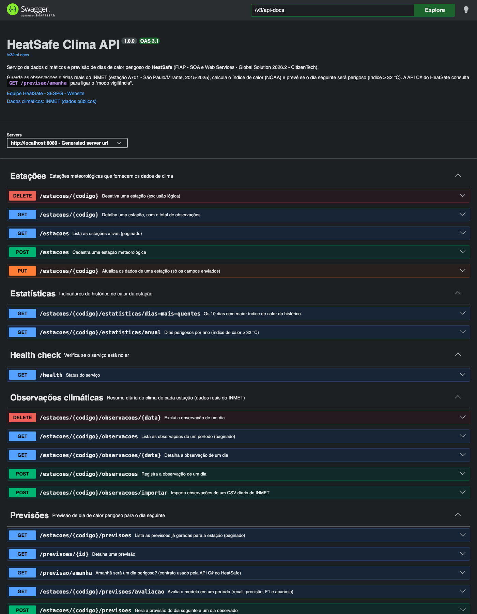

# HeatSafe Clima API — serviço de clima e previsão de calor perigoso

| | |
|---|---|
| **Instituição** | FIAP |
| **Curso** | Engenharia de Software — 3ESPG |
| **Disciplina** | Arquitetura Orientada a Serviços (SOA) e Web Services |
| **Atividade** | Global Solution 2026.2 — CitizenTech |
| **Professor** | Carlos Eduardo Machado de Oliveira |

## Integrantes do grupo

| Nome | RM |
|---|---|
| Felipe Braunstein e Silva | 554483 |
| Felipe do Nascimento Fernandes | 554598 |
| Henrique Ignacio Bartalo | 555274 |
| Gustavo Henrique Martins | 556956 |

## Ficha da CitizenTech

| Campo | Resposta |
|---|---|
| **Nome** | HeatSafe |
| **Cidade e bairro** | São Paulo, Itaim Paulista (zona leste): casas térreas com telha de fibrocimento |
| **Cidadão beneficiado** | Idosos que moram ou passam o dia sozinhos em casas quentes; familiares e agentes comunitários de saúde da UBS |
| **Problema, em uma frase** | Nos dias de calor extremo, idosos que passam o dia sozinhos em casas quentes podem passar mal sem perceber o risco, e ninguém fica sabendo a tempo. |
| **Como funciona** | Um dispositivo ESP32 dentro da casa mede o calor e o movimento; se a casa fica perigosa e o idoso fica parado ou sem beber água, a família é avisada e, sem resposta, a UBS. **Este serviço prevê na véspera se o dia seguinte será perigoso**, para o HeatSafe entrar em "modo vigilância". |
| **ODS** | 3 (Saúde) · 10 (Redução das desigualdades) · 11 (Cidades sustentáveis) · 13 (Ação climática) |

---

## Descrição

A **HeatSafe Clima API** é o serviço de dados climáticos do HeatSafe. Ela:

1. Guarda as **observações diárias reais do INMET** da estação **A701 (São Paulo – Mirante)**, de **2015 a 2025** (3.996 dias), carregadas automaticamente na primeira execução.
2. Calcula o **índice de calor** (sensação térmica, fórmula oficial da NOAA) e classifica o **nível de risco** (Normal, Atenção, Cautela extrema, Perigo, Perigo extremo).
3. **Prevê se o dia seguinte será perigoso** (índice de calor ≥ 32 °C) com um modelo estatístico de dias análogos, salva cada previsão e **mede a qualidade do modelo** (recall, precisão, F1).
4. Expõe tudo como **API REST documentada com Swagger**, consumida pela API C# do HeatSafe (`GET /previsao/amanha`).

### Papel no HeatSafe (arquitetura orientada a serviços)

```
 [Dispositivo ESP32] ──► [API C# do HeatSafe] ◄──► [App Expo]
                                │
                                │  GET /previsao/amanha   (toda noite)
                                ▼
                     ┌──────────────────────────┐
                     │   HeatSafe Clima API     │  ◄── este repositório (Java / Spring Boot)
                     │   estações, observações, │
                     │   previsões, estatísticas│
                     └────────────┬─────────────┘
                                  │ JPA + Flyway
                                  ▼
                              [MySQL 8]  ◄── dados reais do INMET (A701, 2015–2025)
```

Cada serviço tem sua responsabilidade e seu banco; eles conversam só por HTTP/JSON. O contrato de `GET /previsao/amanha` é o mesmo combinado no documento da equipe:

```json
{ "estacao": "A701", "data": "2026-01-01", "perigoso": false, "probabilidade": 0.193,
  "indiceCalorPrevisto": 29.9, "nivelRisco": "ATENCAO" }
```

---

## Domínio

```
Estacao 1 ──── N ObservacaoClimatica        Estacao 1 ──── N Previsao
  codigo (A701)    data (única por estação)    dataBase → dataPrevista (D+1)
  nome, cidade, uf temperaturas, umidade       indiceCalorPrevisto, probabilidadePerigo
  lat/long/alt     indiceCalorMaximo           perigosa, nivelRisco, metodo
  ativa            nivelRisco, origem          amostrasHistoricas, criadaEm
```

| Pacote | Conteúdo |
|---|---|
| `domain/estacao` | Entidade `Estacao`, DTOs (`DadosCadastroEstacao`, `DadosAtualizacaoEstacao`, `DadosDetalhamentoEstacao`, `DadosListagemEstacao`), repositório e exceções |
| `domain/observacao` | Entidade `ObservacaoClimatica`, enum `OrigemObservacao` (INMET / MANUAL), DTOs com validação, repositório com consultas derivadas e JPQL agregada |
| `domain/previsao` | Entidade `Previsao`, interface `ModeloPrevisao` (**padrão Strategy**), implementação `PrevisaoPorFrequenciaHistorica`, enum `MetodoPrevisao`, DTOs e avaliação do modelo |
| `domain/risco` | Enum `NivelRisco` (faixas NOAA) e `CalculadoraIndiceCalor` (regras de negócio puras, sem framework) |
| `domain/estatistica` | `DadosResumoAnual` (dias perigosos por ano) |

**Regras de negócio no domínio:**
- Índice de calor e nível de risco são **calculados pela API**, nunca enviados pelo cliente.
- Uma estação só tem **uma observação por dia** (restrição única no banco + 409 na API).
- Temperatura mínima não pode ser maior que a máxima; umidade entre 0 e 100%; sem datas futuras.
- Estações são desativadas (**exclusão lógica**) e deixam de aceitar dados e previsões.
- A previsão usa **só dados até o dia base**: nada do futuro entra no cálculo.

---

## Banco de dados e migrações

- **MySQL 8.4** (via `docker-compose.yml`), acessado com **Spring Data JPA / Hibernate**.
- O esquema é criado e versionado **somente pelo Flyway** (`ddl-auto=none`):

| Migração | O que faz |
|---|---|
| `V1__create-table-estacoes.sql` | Tabela `estacoes` (código único) |
| `V2__create-table-observacoes-climaticas.sql` | Tabela `observacoes_climaticas` com FK para estação e **unique (estacao_id, data)** |
| `V3__create-table-previsoes.sql` | Tabela `previsoes` com FK e índice (estacao_id, data_prevista) |
| `V4__insert-estacao-a701.sql` | Cadastra a estação A701 do INMET |

- **Carga inicial:** na primeira execução, `CarregadorDadosInmet` importa `src/main/resources/dados/inmet_a701_diario_2015_2025.csv` (dados reais do INMET já tratados). Se a estação já tiver dados, nada é feito.

---

## Endpoints

Documentação interativa: **http://localhost:8080/swagger-ui.html** · OpenAPI JSON: **http://localhost:8080/v3/api-docs**

| Método | Rota | Descrição |
|---|---|---|
| GET | `/health` | Status do serviço |
| POST | `/estacoes` | Cadastra estação (201 + Location; 409 se o código já existe) |
| GET | `/estacoes` | Lista estações ativas (paginado) |
| GET | `/estacoes/{codigo}` | Detalha estação, com total de observações |
| PUT | `/estacoes/{codigo}` | Atualiza os campos enviados |
| DELETE | `/estacoes/{codigo}` | Desativa (exclusão lógica) |
| POST | `/estacoes/{codigo}/observacoes` | Registra observação do dia (calcula índice de calor e nível) |
| POST | `/estacoes/{codigo}/observacoes/importar` | Importa CSV diário do INMET (multipart, campo `arquivo`); ignora dias já cadastrados |
| GET | `/estacoes/{codigo}/observacoes?inicio&fim&somentePerigosos` | Lista observações de um período (paginado) |
| GET | `/estacoes/{codigo}/observacoes/{data}` | Detalha a observação de um dia |
| DELETE | `/estacoes/{codigo}/observacoes/{data}` | Exclui a observação de um dia |
| **GET** | **`/previsao/amanha?estacao=A701`** | **Contrato da API C#: o dia seguinte ao último observado será perigoso?** |
| POST | `/estacoes/{codigo}/previsoes` | Gera e salva previsão a partir de um dia base (`{"dataBase": "2023-11-14"}`) |
| GET | `/estacoes/{codigo}/previsoes` | Lista previsões geradas (paginado) |
| GET | `/previsoes/{id}` | Detalha uma previsão |
| GET | `/estacoes/{codigo}/previsoes/avaliacao?inicio&fim&limiar` | Avalia o modelo no período (matriz de confusão, recall, precisão, F1, acurácia) |
| GET | `/estacoes/{codigo}/estatisticas/anual` | Dias perigosos por ano |
| GET | `/estacoes/{codigo}/estatisticas/dias-mais-quentes` | Top 10 dias com maior índice de calor |

**Erros:** 400 (lista de campos inválidos ou regra de negócio), 404 (estação/observação/previsão inexistente), 409 (duplicidade). Tratados em `infra/exception/TratadorGlobalErros`.

---

## Modelo de previsão

`PrevisaoPorFrequenciaHistorica` procura no histórico os **dias análogos** ao dia base, ou seja, com índice de calor até ±1,5 °C e no mesmo mês ou num mês vizinho, e olha **o que aconteceu no dia seguinte** a cada um deles:

- **Probabilidade de perigo** = fração desses "dias seguintes" com índice de calor ≥ 32 °C.
- **Índice previsto** = média do índice de calor desses "dias seguintes".
- Se houver menos de 20 análogos, a busca é ampliada (±3 °C, qualquer época). Com menos de 5, a API responde 400 (histórico insuficiente).

A interface `ModeloPrevisao` permite trocar este modelo pelo **XGBoost** treinado na disciplina de IA/ML (`MetodoPrevisao.MODELO_ML`) sem mudar o serviço nem a API.

### Avaliação (backtest com dados reais)

Para cada dia, a previsão usa só o histórico anterior e é comparada com o que realmente aconteceu. Os dias perigosos são raros (4,2%), então a **acurácia engana**: o que importa é o **recall**, porque deixar de avisar um dia perigoso é o pior erro.

| Limiar | Validação 2019–2022 (F1) | Teste 2023–2025: recall | Precisão | F1 |
|---|---|---|---|---|
| 0,15 | 0,388 | 0,699 | 0,460 | 0,555 |
| **0,20 (padrão)** | **0,418** | **0,602** | **0,538** | **0,568** |
| 0,30 | 0,294 | 0,398 | 0,623 | 0,486 |
| 0,40 | 0,080 | 0,193 | 0,640 | 0,297 |

O limiar **0,20** foi escolhido pelo melhor F1 no período de **validação (2019–2022)** e depois medido no período de **teste (2023–2025)**: o modelo antecipa **6 em cada 10 dias perigosos** com um dia de antecedência. O limiar pode ser alterado pela variável `LIMIAR_PREVISAO`.

---

## Como executar

### Requisitos
- **JDK 21 ou superior** (testado com JDK 25)
- **Docker** (para o MySQL), ou um MySQL 8 próprio
- **IntelliJ IDEA** (ou outra IDE com Maven). O Maven Wrapper (`mvnw`) acompanha o projeto.

### 1. Subir o MySQL
```bash
docker compose up -d
```
Cria o banco `heatsafe` (usuário `root`, senha `heatsafe`) na porta 3306.

### 2. Rodar a aplicação
- **IntelliJ:** abra a pasta do projeto, aguarde o Maven importar e rode `HeatSafeClimaApiApplication`.
- **Terminal:**
  ```bash
  ./mvnw spring-boot:run
  ```

Na primeira execução o Flyway cria as tabelas e a API carrega os 3.996 dias do INMET (cerca de 2 segundos). Depois, acesse **http://localhost:8080/swagger-ui.html**.

### Variáveis de ambiente (todas opcionais)

| Variável | Padrão | Descrição |
|---|---|---|
| `DB_URL` | `jdbc:mysql://localhost:3306/heatsafe?createDatabaseIfNotExist=true` | URL do MySQL |
| `DB_USER` | `root` | Usuário |
| `DB_PASSWORD` | `heatsafe` | Senha (igual à do `docker-compose.yml`) |
| `PORT` | `8080` | Porta HTTP |
| `CARREGAR_INMET` | `true` | Carrega os dados do INMET na primeira execução |
| `LIMIAR_PREVISAO` | `0.2` | Probabilidade a partir da qual o dia seguinte é perigoso |
| `CORS_ALLOWED_ORIGINS` | `http://localhost:8081,...` | Origens liberadas (app e API C#) |

---

## Testes automatizados

```bash
./mvnw test
```

**28 testes** (JUnit 5, AssertJ, MockMvc, H2 em modo MySQL). **As migrações do Flyway também rodam nos testes**, então o esquema testado é o mesmo da produção.

| Classe | O que testa |
|---|---|
| `CalculadoraIndiceCalorTest` | Fórmula NOAA (mesmos valores do script Python dos dados do INMET) e validação de umidade |
| `NivelRiscoTest` | Faixas de risco e limites |
| `PrevisaoPorFrequenciaHistoricaTest` | Probabilidade por dias análogos, sem vazamento de dados do futuro, buracos nos dados, histórico insuficiente |
| `ObservacaoRepositoryTest` | Migrações, unicidade estação+dia, consulta JPQL do resumo anual, histórico ordenado |
| `EstacaoControllerTest` | CRUD de estações: 201 + Location, 400 com campos, 409, 404 após desativar |
| `ObservacaoPrevisaoIntegracaoTest` | Fluxo completo: importação de CSV, reimportação sem duplicar, CSV inválido, filtros, cálculo do índice, 409, contrato `/previsao/amanha`, previsão, avaliação e resumo anual |

---

## Evidências

Geradas com a aplicação rodando no MySQL, com os dados reais do INMET (pasta [`docs/evidencias`](docs/evidencias)):

| Arquivo | Conteúdo |
|---|---|
| `00-log-inicializacao-flyway-e-carga.txt` | Flyway aplicando as 4 migrações e carga dos 3.996 dias |
| `02-estacao-a701.json` | Estação com `totalObservacoes: 3996` |
| `03-observacoes-onda-de-calor-nov-2023.json` | Onda de calor de novembro de 2023 (recorde em 15/11: 35,5 °C de índice de calor) |
| `04-dias-perigosos-por-ano.json` | Dias perigosos por ano: 2023 (27) e 2024 (36) foram os piores |
| `06-previsao-vespera-recorde.json` | Na véspera do recorde, o modelo deu 51% de chance de perigo e acertou |
| `07-previsao-amanha-contrato-api-csharp.json` | Resposta do contrato usado pela API C# |
| `08` e `09` | Avaliação do modelo nos períodos de teste e validação |
| `10-tratamento-de-erros.txt` | Respostas 400, 404 e 409 |
| `12-banco-mysql-tabelas-e-flyway.txt` | Consulta direta ao MySQL: tabelas, `flyway_schema_history` e contagens |



---

## Tecnologias

Java 21 · Spring Boot 4.0.5 · Spring Web MVC · Spring Data JPA (Hibernate) · Bean Validation · Flyway · MySQL 8.4 · springdoc-openapi 3.0.3 (Swagger UI) · Lombok · JUnit 5 · AssertJ · MockMvc · H2 (só nos testes) · Docker Compose · Maven

## Estrutura de pastas

```
src/main/java/br/com/fiap3espg/heatsafe
├── controller/        Estacao, Observacao, Previsao, Estatistica, HealthCheck
├── service/           EstacaoService, ObservacaoService, ImportacaoObservacoesService, PrevisaoService, EstatisticaService
├── domain/
│   ├── estacao/       Entidade, DTOs (records), repositório, exceções
│   ├── observacao/    Entidade, DTOs, repositório (consultas derivadas + JPQL), exceções
│   ├── previsao/      Entidade, ModeloPrevisao (Strategy), PrevisaoPorFrequenciaHistorica, DTOs
│   ├── risco/         NivelRisco, CalculadoraIndiceCalor
│   └── estatistica/   DadosResumoAnual
└── infra/
    ├── config/        CarregadorDadosInmet (carga inicial), CorsConfig
    ├── documentation/ SwaggerConfig (OpenAPI)
    └── exception/     TratadorGlobalErros
src/main/resources     application.properties, db/migration (Flyway), dados/ (CSV do INMET)
src/test               Testes automatizados e application-test.properties (H2 modo MySQL)
docs/                  Evidências e prints
```

## Fonte dos dados

INMET — Instituto Nacional de Meteorologia, Banco de Dados Meteorológicos (BDMEP), dados históricos anuais da estação automática A701 (São Paulo – Mirante), 2015–2025: https://portal.inmet.gov.br/dadoshistoricos. O tratamento (limpeza, fuso horário, índice de calor, agregação diária) está documentado no repositório de dados da equipe.
